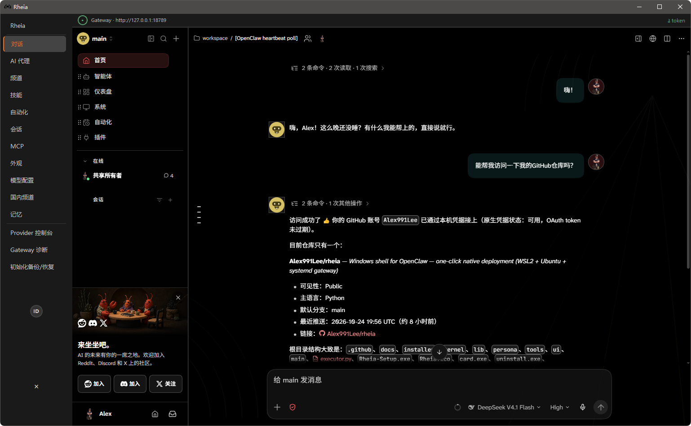

# Rheia

**把 Linux 服务器级的 OpenClaw，做成一次双击。**

下载、双击、等进度条走完 —— 得到的是一个和 Linux 服务器上一样的 OpenClaw：官方包、官方网关、开机自启、带界面。

**[English](README.md)** | **简体中文**

**[⬇ 下载 Rheia-Setup.exe](./Rheia-Setup.exe)**

📖 **[为什么会有 Rheia](https://alex991lee.github.io/rheia/blog/install-openclaw-on-windows.html)** · 3.55 MB · SHA256 `7fe98d80e418b7074577f6a3effbe106e537c68ba832a5e926213f944811f4e3`


<p align="center"></p>

---

## 我们和其它 Windows 方案有什么不同

OpenClaw 在 Windows 上目前有三条路。官方的两条都成立，但 Rheia 将成为你的最优解：

| | 官方 PowerShell 直装 | 官方 Windows Hub | **Rheia** |
|---|---|---|---|
| 形态 | 命令行安装 | WinUI 桌面应用 | **桌面外壳** |
| 运行时 | 原生 Windows 进程 | 另建一个 app 专属 WSL 发行版（`OpenClawGateway`） | **你原有的 WSL2 + Ubuntu** |
| 是否原生 OpenClaw | 是 | 是 | **是（官方 npm 包，未改动）** |
| 安装权限 | 需按步骤手工执行 | 免管理员 | **管理员 —— 换取 systemd 服务级可靠性** |
| 已有 Ubuntu | 不涉及 | 与之并存，磁盘多一份 | **复用，零浪费** |
| 开机自启 | 自行配置 | 托盘 | **systemd 服务，随机器启动** |
| 国内下载 | 直连官方源 | 直连官方源 | **国内/国际镜像自动切换** |
| 界面 | 无（浏览器自开） | 官方 Companion | **内置浏览器 + 管理面板，29 种语言** |

还在为安装原生 OpenClaw 时敲错一个字符而懊恼吗？双击 `Rheia-Setup.exe`，然后去给自己倒一杯咖啡——也许咖啡还没喝完，你就会发现 OpenClaw 已经能用了。

**官方 Windows 方案过去出过几次公开故障**（链接可自行核对，均为 closed 状态）：

- 2026-06 · 安装前检查中断：报 `WSL version output did not include a parseable WSL version`。根因是**非英文系统下 `wsl --version` 的输出字段被本地化**（该例为瑞典语环境），次日修复（[#694](https://github.com/openclaw/openclaw-windows-node/issues/694)）
- 2026-06 · 全新安装未注册出 `OpenClawGateway` 发行版，四天内修复（[#775](https://github.com/openclaw/openclaw-windows-node/issues/775)）
- 2026-02 · WSL 内 `gateway connect` 失败，报 `gateway closed (1008): pairing required`（[openclaw#22445](https://github.com/openclaw/openclaw/issues/22445)）—— 官方标记为 **closed as not planned**（不计划修复）

Rheia 的设计与官方 Windows Hub 或许有些分歧，这完全是因为设计思想不同使然：它会为 OpenClaw 新建一个专属的 `OpenClawGateway` 发行版——需要说明的是，这一设计在官方文档中便是如此定义，这不是缺陷，是选择；Rheia 则会复用你已有的 Ubuntu。两种都成立——差别只在于：如果你已经有一个 Ubuntu，Rheia 不会让你再养第二份。

Rheia 始终奉行一条：**忠实于官方发行版，让 Ubuntu 变成最适合一人公司和小规模创业团队的优质生产力基座**。

---

## 29 种语言，没有一种是硬贴上去的

界面、每一个面板、每一个对话框、以及安装向导，全部是 **29 种语言**：

`ar bg ca cs da de el en es fa fi fr he hr hu it ka ko lv nl nn pl pt_BR ru sk sv tr uk zh`

启动时读 Windows 显示语言；`RHEIA_LOCALE` 可以覆盖；不支持的语种一律回落英文，而不是给你半张翻译过的界面。按钮先按文案定尺寸，其次缩字号，再次换行，最后才另起一行——**再长的俄语标签也不会挤到邻居底下**。

向导、安装日志、各面板共用同一张字符串表：一处修好，处处生效。

---

## 五个要点

### 1. 安装时就知道该走哪条线

安装器会自动探测你的网络环境：国内用户自动走镜像源，海外用户直连官方源 —— 不用手动操作任何配置，装的时候 Rheia 将自己挑最快的那条路；测速不过关的源直接跳过，而不是干等到超时。

### 2. 壳层预装：装完就能办公

装完不是一个空 OpenClaw。网关连通后，壳立刻在后台静默装上一批东西——全是日常办公用得着的：

| 预装项 | 类型 | 干什么 |
|---|---|---|
| `@openclaw/tavily-plugin` | 插件 | 联网搜索，`web_search` 的 provider |
| `@mem9/mem9` | 插件 | 持久记忆服务，跨会话不失忆 |
| `@weiwei2027/office-toolkit` | 技能 | 文档处理：Word / Excel / PPT / PDF |
| `@cindypapa/agent-browser` | 技能 | 浏览器自动化 |
| `@paudyyin/summarize` | 技能 | 长文摘要 |
| `@pskoett/self-improving-agent` | 技能 | 复盘与自我改进 |
| `@guipi888/find-skills` | 技能 | 技能检索 |
| `@spclaudehome/skill-vetter` | 技能 | 技能审查 |

**配套依赖一并直装，不给客户留缺口：**

- **转换引擎**：`apt install libreoffice` —— `soffice`（文档格式互转全靠它）
- **Python 文档库**（pip）：`python-docx`（Word）、`python-pptx`（PPT）、`openpyxl`（Excel）、`pymupdf`（PDF 读写）、`reportlab`（PDF 生成）—— 走阿里云源，失败回落官方源
- **浏览器**：`npm i -g agent-browser` + `agent-browser install`（Chrome 内核）

**三条工程细节，看得出这不是手装清单：**

- **装的是名字，不是分类** —— 每个名字是 skill 还是 plugin，由 CLI 当场判定。官方哪天把 skill 升级成 plugin，清单一个字不用改
- **幂等** —— 标记文件防止重复执行，重装、续装都不会重复下载
- **失败不装死** —— 失败项写进 `failed_skills.json`，界面可见，可重试

查自己机器上的实际清单：

```bash
openclaw plugins list
openclaw skills list
```

### 3. 三个多月，核心没变

Rheia 本身只是一个壳 —— OpenClaw 是那个超级英雄，Rheia 是那身战衣。战衣不改造英雄，只负责一件事：把官方原生 OpenClaw 的使用门槛降到零，让不懂 Linux 命令的普通人也能驾驭这个超级智能体平台。

Rheia 起步于 2026.6.33（7 月 21 日），到今天 2026.10.30，三个多月、四条主线，官方迭代很快。Rheia 的应对只有一句话：以不变应万变 —— 把"装 OpenClaw"和"呈现 OpenClaw"分开，官方怎么改，壳只适配，不推倒。动的都是外围 —— 面板、镜像、文案、边界处理，越磨越细。安装包也从 GB 级一路压缩到 3.55MB。

### 4. 我们坚持原生，不做魔改

Rheia 不 fork OpenClaw，不 patch 源码，不打自己的包：装的是官方 `npm install -g openclaw@latest`，用的是官方网关、官方插件体系、官方 Control UI。壳只做三件事 —— 装环境、拉起网关、开界面。

这是不争的优势：官方每次迭代，Rheia 都将立即跟进，始终贴合 upstream 最新 —— 保证你拿到的是最新那一版，而不是半年前的某个过时发行版。

你机器上的 OpenClaw 就是官方那个。官方文档、官方社区、官方 issue 区全都对得上，出了问题，直接对照官方文档排查，不用等我们翻译一遍。

### 5. 交付到手，接近满血

装完之后客户手上是一个**完整运行时**：

```
WSL2 + Ubuntu（复用你已有的）
  └─ Node.js
      └─ OpenClaw（官方最新版）
          ├─ 壳层预装 8 项（2 插件 + 6 技能）
          ├─ 配套：LibreOffice / Chrome 内核
          ├─ Gateway（systemd 服务，开机自启）
          └─ Control UI（内置浏览器直开）
```

不是"能跑起来"，是**能直接干活**。

---

## 它在你机器上做了什么

**权限越高，越要透明。** 安装器权限较高，所以每一步都摊开写：

**系统层**
- 启用 WSL2 与虚拟机平台（`dism`），需管理员；首次可能重启一次，重启后自动续装
- 导入 Ubuntu 云镜像为 WSL 发行版（默认名 `Ubuntu`，可用 `RHEIA_WSL_DISTRO` 覆盖）
- 在发行版内安装 apt / pip 依赖、Node.js，再用 npm 安装 OpenClaw
- 注册 systemd 服务，网关开机自启
- Python 运行时装在 `C:\Program Files\PythonSide6`（共享；卸载不删除）

**文件落点**
- `{app}`：程序本体
- `C:\ProgramData\Rheia\`：`install.log`、`download.log`、进度文件
- `%TEMP%\okoc_signal.txt`：向导与安装进程之间的进度信号（临时）

**它不做的事**
- 不上传对话内容
- 不发遥测、不做设备指纹
- 不在安装目录之外生成数据文件
- **不给你看任何控制台窗口** —— 安装链与启动链上的每个子进程都带 `CREATE_NO_WINDOW`（见下文「工程细节」）

---

## 安装流程

```
step0  自检
step2  启用 WSL2          step3  启用虚拟机平台
       └─ 需要时重启，RunOnce 自动续装
step4  请求重启（仅在内核需要时）
step5  导入 Ubuntu        step55 配置 apt / pip / venv
step6  安装 Node.js       step7  npm 安装 OpenClaw
step8  systemd + Gateway  step85 预热核心数据（scout / large）
step9  提取网关信息 → 拉起主界面
```

进度区间：解压 0–5 ｜ 下载 5–25 ｜ dism 26–40 ｜ Ubuntu 41–60 ｜ Node 61–65 ｜ npm 66–85 ｜ systemd 81–90 ｜ 界面 96–100

取消会写 `%TEMP%\Rheia_cancel.flag`，安装进程检测到后回滚。

---

## 界面

| 面板 | 干什么 |
|---|---|
| **内置浏览器** | 承载 Control UI，单实例、按需自愈，三态状态灯（已连接 / 重试中 / 断开） |
| **Provider 控制台** | 首次无 key 自动弹快速配置；完整控制台按 provider 展示状态灯、填 API key、启停；只写 `models.providers.<id>.apiKey` 与 `enabled` |
| **高级配置** | Provider 控制台的子页，面向自定义 provider —— 一个通用解析器 + 按 provider 声明取字段，新增 provider 是加数据，不是改代码 |
| **中国国内频道** | 微信 / QQ机器人 / 飞书三频道极简配置，对齐官方 CLI 流程，执行输出实时可见 |
| **Gateway 诊断** | WSL 探活、网关进程、Token 摘要、日志尾行 —— 实时不缓存、三色编码；重启走 `pgrep` 精确取 PID 再 kill，不用裸 `pkill -f` |
| **记忆** | 五个子页，数据来自 `mani.json`：记忆整理（Dreaming）、后台动作、记忆搜索、卡上内容只读、备份恢复 |
| **备份与恢复** | 备份/还原 `baseline_pool.db`（偏好、凭据、恢复状态、高级 Provider），以及把对话导出成 .md |

---

## 目录结构

```
extract/          安装向导（Inno Setup 脚本 + card.c 自绘界面 + 卸载器）
installer/        安装步骤 step0–step9、镜像源 mirrors.json、组件声明、安装引擎
main/             日常入口：唤醒 VM → 探活网关 → 内置浏览器
                  boot_worker（内核重活）/ install_worker（后台装机链）
ui/web/           各面板：浏览器 / Provider / 高级配置 / 诊断 /
                  记忆 / 备份 / 频道 / 支持
ui/translations/  29 种语言，共用一张字符串表
kernel/           数据驱动引擎 —— scout（采集 → 过滤 → 探查）→ large
                  （manifest → am → steak → forge）→ 渲染
lib/              进程级守卫（no_window）与公共helper
```

约 6 万行源码（其中 Python 4.7 万行），加 1.9 万行 29 语言字符串表，再加一个自绘的 `card.exe` 向导界面；客户不需要自己手装任何第三方运行时。

---

## 工程细节

**1. 静默是构造出来的，不是记出来的。** `lib/no_window.py` 在每个进程入口把 `subprocess.Popen` 包一层：调用方没显式给 `creationflags` 的，一律补 `CREATE_NO_WINDOW`；显式指定过的（`DETACHED_PROCESS` 之类）原样不动。装 Rheia、开 Rheia，**全程不闪黑框**——这是进程本身的性质，不是靠人每次记得加参数。

**2. 进度原子写，UI 只做轻活。** worker 进程把进度 JSON 先写 `.tmp` 再 `os.replace`；UI 一秒读一次。重活不上 UI 线程，UI 崩了也不会毁掉安装链。

**3. 面板是数据驱动的。** 面板只是壳，开关名、默认值、命令都来自 `mani.json`——由 `kernel/scout` 从官方文档语料里采出来。官方加了新旋钮，面板跟着长，不用改代码。

**4. 精确，不下宽刀。** 重启网关先取 PID 再杀那一个，不用 `pkill -f` 顺手带走无关进程。

**5. 数据不出机器。** 无遥测、无指纹、不上传对话；唯一的外连是 npm / apt / 官方文档。

---

## 从源码构建

环境：Windows 10/11 x64、[Inno Setup 6.3+](https://jrsoftware.org/isinfo.php)（含 ISPP）、MSVC

```bat
cd extract
_build_card.bat        :: 编译 card.exe
_build_uninstall.bat   :: 编译 uninstall.exe
ISCC setup.iss         :: 出包 -> ..\Released\Rheia-Setup.exe
```

---

## 关于界面，我们诚实交底

**PySide6（QtWebEngine）在部分机器上有界面闪动。**

成因在 Chromium 合成层，不在业务代码：同一套 Control UI 在 Chrome 里正常，在 QtWebEngine 里会反复重绘。我们试过 GPU flag、D3D11 后端、减弱动效，能压住一部分，但不能对所有显卡保证。

三件事说清楚：

1. **这是选型时就知道的取舍，不是事故** —— 选 PySide6 是为了绕开 Qt 的商业授权；我们清楚它的代价，也接受这个代价
2. **不用补丁掩盖** —— GPU flag、D3D11 后端、减弱动效都试过，能压住一部分，压不住全部；根治的办法写进了路线图（换语言、买商业许可）
3. **透明本身就是产品的一部分** —— 先告诉你会遇到什么、我们打算怎么解决，比等你碰上再解释强

---

## 捐赠

本项目免费开源，捐赠**完全自愿**，不影响任何功能——不捐也照样全功能使用，不锁任何东西。界面有一个支持入口，它就出现在那一处，关掉即走。

捐赠的用途，说清楚：

- **一部分**用于开发者生活，让这件事能持续做下去
- **主要部分**投进技术改进，其中一项明确的方向是：**换编程语言、购买商业许可**，从根上绕开 PySide6 的界面缺陷，把更好的产品交到客户手上

也就是说，你捐的每一分不是打赏，是**投资**：买下一版更好的界面，也买下这个项目能长期走下去。

---

## 许可

本仓库以 **MIT License** 发布，见 `LICENSE`。

- **OpenClaw** — MIT，© 2026 OpenClaw Foundation。Rheia 安装与管理它，不修改它。
- **PySide6 / Qt for Python** — 主体 LGPLv3，© The Qt Company 及贡献者。

---

## 已知边界

- **聚焦 Windows x64 做深做透**，而不是每个平台都做一半；需管理员权限（WSL2 与服务注册）
- **首次安装要下载运行时** —— 一次性投入，之后每次更新都是增量；国内自动走镜像
- **卸载不删 `C:\Program Files\PythonSide6`** —— 刻意的克制：只清自己装的，不越界、不误伤（多产品共享）
